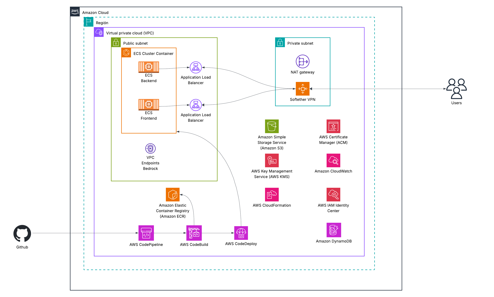

# ModTester


AI-powered penetration testing platform that lets security professionals conduct vulnerability assessments using natural language. Built on [Model Context Protocol (MCP)](https://modelcontextprotocol.io) and powered by Amazon Bedrock (Claude Opus 4.7).

ModTester orchestrates 65 offensive security tools autonomously through a web UI. You describe the engagement, it executes the full kill chain — reconnaissance through reporting — and presents findings in a professional dashboard.

## Quick Start

```bash
cp .env.example .env          # Configure credentials (see below)
docker compose up -d          # Starts Backend + UI + DynamoDB Local
```

Open **http://localhost:4000** and log in. That's it.

### Environment Variables

| Variable | Description |
|----------|-------------|
| `AWS_ACCESS_KEY_ID` | AWS credentials for Bedrock |
| `AWS_SECRET_ACCESS_KEY` | AWS credentials for Bedrock |
| `AWS_DEFAULT_REGION` | Region (default: `us-east-1`) |
| `BEDROCK_MODEL` | Model ID — must use `us.` cross-region inference profile prefix (e.g. `us.anthropic.claude-opus-4-7`) |
| `AUTH_SECRET` | JWT signing secret |
| `DEMO_PASSWORD` | Login password |

## Architecture



```
Browser (localhost:4000)
    ↓
Next.js UI ──── REST/SSE ────→ Python Backend (localhost:4001)
                                     ↓
                              FastMCP Server → 65 CLI Tools → Target
                                     ↓
                              Knowledge Layer (ASVS, PTES, Playbooks)
                                     ↓
                              DynamoDB (assessments, findings, chat history)
                                     ↓
                              S3 (evidence artifacts)
```

### Services (Docker Compose)

| Service | Port | Description |
|---------|------|-------------|
| **UI** | 4000 | Next.js dashboard (assessments, chat, reports) |
| **Backend** | 4001 | Python MCP server + REST API + AI chat |
| **DynamoDB Local** | 4002 | Persistent local database |

## Integrated Tools (65)

| Category | Count | Tools |
|----------|-------|-------|
| Web | 10 | httpx, ffuf, katana, nikto, waybackurls, feroxbuster, http headers, cookie analysis, http methods |
| Tracking | 8 | target state management (add targets, ports, credentials, vulns, scan logs) |
| Sessions | 6 | interactive shell sessions (create, exec, read, close, list, history) |
| Reporting | 5 | findings management, evidence import, compliance-mapped report generation |
| Verification | 5 | verify_sqli, verify_rce, verify_lfi, verify_default_creds, verify_cve |
| Auth | 5 | login handling, token management, header injection, auth testing |
| Evidence | 4 | capture, list, retrieve, clear (S3-backed in production) |
| Vulnerability | 4 | nuclei, sqlmap, sqli payloads, commix |
| Network | 3 | nmap, masscan, netcat |
| DNS | 3 | dns lookup, whois, crt.sh |
| Recon | 3 | subfinder, arjun, attack surface mapping |
| API | 2 | JWT testing, GraphQL introspection |
| Credentials | 2 | credential testing, default creds check |
| Exploitation | 2 | searchsploit search, searchsploit examine |
| SSL | 2 | testssl, sslscan |
| WordPress | 1 | wpscan |

## Standards & Compliance

Findings are automatically mapped to:

- **OWASP ASVS 4.0** — 286 verification requirements across 14 chapters
- **PTES** — 7-phase penetration testing methodology
- **NIST 800-53**, PCI-DSS, CIS Benchmarks
- HIPAA, SOC 2, GDPR

## AWS Deployment

Three separate CloudFormation templates in `AWS/` for granular control:

| Stack | Template | Description |
|-------|----------|-------------|
| Backend | `AWS/ECS.yml` | VPC, ECS cluster, backend service, DynamoDB, S3, KMS, ALB, Bedrock VPC endpoint, CI/CD pipeline |
| UI | `AWS/ECS-UI.yml` | Next.js UI service on existing cluster, internal ALB, CI/CD pipeline |
| VPN | `AWS/VPN.yml` | Softether VPN on EC2 for private network access |

**Prerequisites for `deploy.sh`:**

- AWS CLI v2 installed and configured (`aws configure`)
- IAM user/role with permissions for: CloudFormation, ECS, EC2, VPC, IAM, S3, DynamoDB, KMS, ECR, Route53, ACM, CodePipeline, CodeBuild, CloudWatch, ELB
- A Route53 public hosted zone for your domain (if using HTTPS with auto-generated wildcard cert)
- A CodeStar Connection to GitHub (for CI/CD pipeline). Create one in the AWS Console under Developer Tools → Connections, then provide the ARN during setup
- Python 3 installed (used for JSON parsing during DNS cleanup)
- Bash shell (macOS/Linux)

**Deploy all 3 stacks with the automated script:**

```bash
./AWS/deploy.sh                    # Interactive — prompts for all configuration
./AWS/deploy.sh --only backend     # Deploy only the backend stack
./AWS/deploy.sh --only ui          # Deploy only the UI stack
./AWS/deploy.sh --only vpn         # Deploy only the VPN stack
./AWS/deploy.sh --destroy          # Tear down ALL stacks
./AWS/deploy.sh --destroy vpn      # Tear down only the VPN stack
./AWS/deploy.sh --destroy ui       # Tear down only the UI stack
./AWS/deploy.sh --destroy backend  # Tear down only the backend stack
./AWS/deploy.sh --help             # Show help
```

The script is fully interactive — it prompts for every value with sensible defaults. Just press Enter to accept defaults for a quick deploy.

**What the script prompts for:**

| Section | Parameters |
|---------|-----------|
| **General** | Region, CustomerName, EnvironmentName |
| **Networking** | VPC CIDR, Public/Private subnet CIDRs |
| **TLS** | 1) Private CA + internal domain, 2) Existing ACM cert + public domain, 3) HTTP only |
| **ECS/Compute** | Instance type, AMI, capacity, max size, image tag |
| **AI/Backend** | Bedrock model, auth secret |
| **Web UI Credentials** | Username, password |
| **CI/CD** | GitHub repo, branch, CodeStar connection ARN (optional) |
| **VPN** | Hub name, IPsec PSK, admin password, VPN username/password |

**Destroy behavior:**
- Empties S3 buckets (including versioned objects) before stack deletion
- Deletes all ECR images in stack repositories
- Only asks for Region, CustomerName, and EnvironmentName

**`--only` behavior:**
- Only prompts for variables relevant to the targeted stack
- `--only vpn` asks: General + VPN config only
- `--only backend` asks: General + Networking + TLS + ECS + AI + CI/CD
- `--only ui` asks: General + TLS + CI/CD

**Post-deploy actions:**
- Scales ECS services to 1 desired task after stack creation
- Optionally creates Route53 DNS records for public domains
- Displays connection summary with all URLs and credentials

**Or deploy individually:**

```bash
# 1. Backend (creates VPC, cluster, DynamoDB, S3, etc.)
aws cloudformation create-stack \
  --template-body file://AWS/ECS.yml \
  --stack-name modtester-dev-backend \
  --parameters \
    ParameterKey=CustomerName,ParameterValue=modtester \
    ParameterKey=EnvironmentName,ParameterValue=dev \
  --capabilities CAPABILITY_NAMED_IAM

# 2. UI (uses outputs from backend stack)
aws cloudformation create-stack \
  --template-body file://AWS/ECS-UI.yml \
  --stack-name modtester-dev-ui \
  --parameters \
    ParameterKey=CustomerName,ParameterValue=modtester-ui \
    ParameterKey=EnvironmentName,ParameterValue=dev \
    ParameterKey=ECSClusterName,ParameterValue=<from-backend-output> \
    ParameterKey=VPCId,ParameterValue=<from-backend-output> \
    ParameterKey=PrivateSubnetOne,ParameterValue=<from-backend-output> \
    ParameterKey=PrivateSubnetTwo,ParameterValue=<from-backend-output> \
    ParameterKey=ContainerSecurityGroupId,ParameterValue=<from-backend-output> \
    ParameterKey=BackendAPIURL,ParameterValue=https://api.yourdomain.com \
  --capabilities CAPABILITY_NAMED_IAM

# 3. VPN (optional — for private access)
aws cloudformation create-stack \
  --template-body file://AWS/VPN.yml \
  --stack-name modtester-dev-vpn \
  --parameters \
    ParameterKey=VPCId,ParameterValue=<from-backend-output> \
    ParameterKey=SubnetIdPublicSoftether,ParameterValue=<public-subnet-id> \
    ParameterKey=NameBurtualHubVPN,ParameterValue=ModTester \
    ParameterKey=IPsecPreSharedKey,ParameterValue=<psk> \
    ParameterKey=SoftetherPassword,ParameterValue=<password> \
    ParameterKey=VPNUsername,ParameterValue=modtester \
    ParameterKey=VPNUserPassword,ParameterValue=<vpn-pass> \
  --capabilities CAPABILITY_NAMED_IAM
```

### Infrastructure Features

| Feature | Details |
|---------|---------|
| **Compute** | ECS on EC2 (t3a.medium) with Auto Scaling |
| **Networking** | Private VPC, dual-AZ, NAT Gateways, internal ALBs |
| **Encryption** | KMS at rest (DynamoDB, S3), TLS 1.3 in transit |
| **VPC Endpoints** | Bedrock Runtime (keeps AI traffic private, off public internet) |
| **CI/CD** | CodePipeline + CodeBuild (GitHub → ECR → ECS deploy) |
| **DNS** | Route53 private hosted zone (`api.vpc.local`, `ui.vpc.local`) |
| **Certificates** | ACM certificate (user-provided) for HTTPS |
| **VPN** | Softether L2TP/IPsec for remote access to private network |
| **Evidence** | S3 with versioning, KMS encryption, Glacier archival |
| **Monitoring** | CloudWatch Container Insights, log retention 7 days |

### Default Credentials

| Service | Username | Password |
|---------|----------|----------|
| Web UI | `admin` | `ModTester@2026!` |

Configurable via `MODTESTER_USER` and `MODTESTER_PASS` environment variables.

### Estimated Monthly Cost (us-east-2)

Based on default configuration: 1× t3a.medium ECS instance, 1× t3a.medium VPN instance, minimal usage.

| Resource | Specification | Est. Monthly Cost |
|----------|--------------|-------------------|
| **EC2 — ECS Host** | t3a.medium (2 vCPU, 4GB), on-demand | ~$27 |
| **EC2 — VPN (Softether)** | t3a.medium (2 vCPU, 4GB), on-demand | ~$27 |
| **NAT Gateway** | 1× single AZ, data processing | ~$33 |
| **ALB — Backend** | Internal, minimal traffic | ~$16 |
| **ALB — UI** | Internal, minimal traffic | ~$16 |
| **DynamoDB** | 3 tables, on-demand, <1GB storage | ~$1 |
| **S3 — Evidence** | <1GB, KMS encrypted, versioned | ~$1 |
| **S3 — VPN Configs** | Minimal storage | <$1 |
| **S3 — CI/CD Artifacts** | Build artifacts, 30-day lifecycle | <$1 |
| **KMS** | 1 key + API calls | ~$1 |
| **ECR** | 2 repos, ~2GB images | ~$1 |
| **CloudWatch Logs** | Container Insights + logs, 7-day retention | ~$3 |
| **VPC Endpoints** | 1× Bedrock Runtime (AI traffic stays private) | ~$7 |
| **Route53** | Private hosted zone + queries | ~$1 |
| **Elastic IP** | 1× for VPN | ~$4 |
| **CodePipeline** | 1 pipeline (free tier: 1 free) | $0–$1 |
| **CodeBuild** | build.general1.medium, ~10 builds/month | ~$2 |
| **ACM Private CA** | *(removed — not used)* | $0 |
| **Bedrock (Opus 4.7)** | Per-token, usage dependent | Variable |
| | | |
| **Total** | | **~$141/month** |

**Bedrock pricing (Claude Opus 4.7):**
- Input: $15 / 1M tokens
- Output: $75 / 1M tokens
- A typical pentest session uses ~50K–200K tokens → $1–$5 per assessment
- Full blackbox assessments (60+ tool calls) can reach 200K–400K tokens → $5–$20 per run

## CLI Client

For headless or scripted use, `client.py` connects directly to the MCP server:

```bash
pip install -r requirements.txt
python client.py
```

## Documentation

- [docs/SETUP.md](docs/SETUP.md) — Installation and configuration
- [docs/ARCHITECTURE.md](docs/ARCHITECTURE.md) — System design and data flow
- [docs/CONTRIBUTING.md](docs/CONTRIBUTING.md) — Adding new tools

## License

Apache 2.0

---

Built by [Modus Create](https://moduscreate.com)
